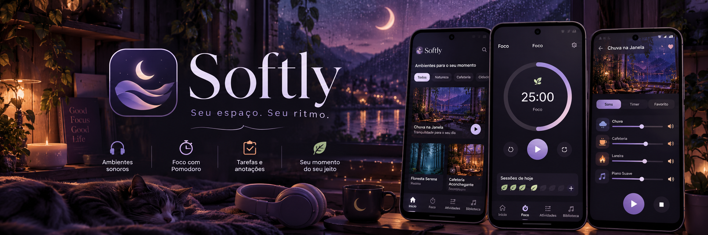
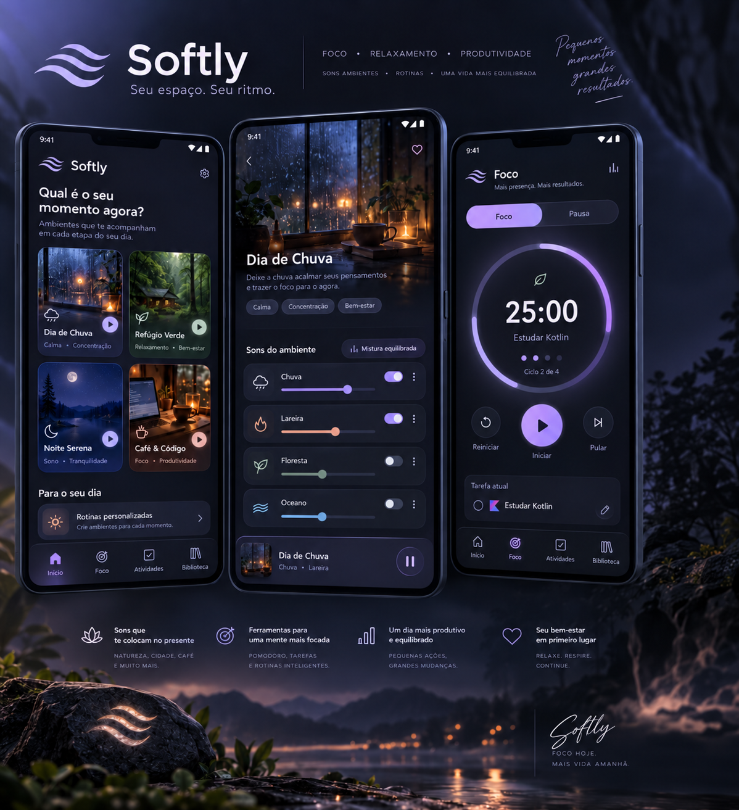

<div align="center">
  
</div>

<br>

# 🌙 Softly

### Seu espaço. Seu ritmo.

**Softly** é um aplicativo Android nativo de concentração, relaxamento e produtividade, desenvolvido com **Kotlin e Jetpack Compose**.

O projeto nasce da proposta de criar um refúgio digital acolhedor, onde cada pessoa possa encontrar seu próprio ritmo por meio de ambientes sonoros, ferramentas de concentração e organização pessoal.

> Um lugar para desacelerar, concentrar-se e aproveitar cada momento.

---

## ✨ Sobre o projeto

O Softly tem como objetivo proporcionar uma experiência imersiva, combinando sons ambientes, temporizador Pomodoro e ferramentas de produtividade em uma interface moderna e acolhedora.

Sua identidade visual utiliza a paleta **Midnight Lavender**, com tons noturnos, lavanda e elementos inspirados em ambientes cinematográficos.

O aplicativo está sendo desenvolvido do zero, com identidade visual e implementação próprias.

**Plataforma inicial:** Android  
**Linguagem:** Kotlin  
**Interface:** Jetpack Compose  
**Status:** Em desenvolvimento

---

## 🎧 Funcionalidades planejadas

### 🌧️ Ambientes sonoros

- Reprodução de sons ambientes.
- Reprodução simultânea de diferentes sons.
- Controle individual de volume.
- Reprodução contínua.
- Funcionamento offline para sons essenciais.
- Reprodução em segundo plano.

### ⏱️ Temporizador Pomodoro

- Sessões de foco e pausa.
- Duração configurável.
- Controles de início, pausa e reinício.
- Indicador visual de progresso.
- Contagem de ciclos concluídos.
- Associação de sessões a tarefas.

### 📝 Organização pessoal

- Cadastro e gerenciamento de tarefas.
- Marcação de tarefas concluídas.
- Criação e edição de anotações.
- Armazenamento local das informações.

### 🎨 Personalização

- Identidade visual Midnight Lavender.
- Temas claro e escuro.
- Preferências armazenadas localmente.
- Interface com ambientes visuais imersivos.

### 🔮 Funcionalidades futuras

- Criação de ambientes personalizados.
- Salvamento de combinações sonoras.
- Favoritos.
- Estatísticas de produtividade.
- Histórico de sessões.
- Biblioteca ampliada de sons.

**Nota:** as funcionalidades apresentadas nesta seção fazem parte do planejamento e serão implementadas progressivamente.

---

## 🛠️ Tecnologias

| Tecnologia | Finalidade |
|---|---|
| Kotlin | Desenvolvimento Android |
| Jetpack Compose | Interface declarativa |
| Material Design 3 | Componentes e identidade visual |
| MVVM | Organização da apresentação |
| StateFlow | Gerenciamento de estados |
| Coroutines | Operações assíncronas |
| Media3 / ExoPlayer | Reprodução de áudio |
| Room | Persistência estruturada |
| DataStore | Armazenamento de preferências |
| Navigation Compose | Navegação |
| Git e GitHub | Versionamento |

As bibliotecas de áudio, navegação e persistência serão adicionadas conforme o avanço da implementação.

---

## 🏗️ Arquitetura

O Softly seguirá uma arquitetura **MVVM com separação simplificada entre apresentação, domínio e dados**.

A organização planejada inclui:

```text
presentation/
    home/
    sounds/
    focus/
    activities/
    notes/
    library/
    settings/

domain/
    model/
    repository/
    usecase/

data/
    local/
    preferences/
    repository/

playback/
    controller/
    service/

navigation/

ui/
    theme/
```

Essa estrutura representa a arquitetura planejada. Os pacotes serão criados progressivamente.

Para mais informações, consulte [Arquitetura do aplicativo](docs/architecture.md).

---

## 🎨 Identidade visual

O Softly possui uma identidade visual própria, chamada **Midnight Lavender**.

### Paleta principal

| Elemento | Cor | HEX |
|---|---|---|
| Fundo | Azul-noturno | `#101322` |
| Superfícies | Azul-acinzentado | `#1C2033` |
| Primária | Lavanda | `#B6A4F2` |
| Secundária | Verde-sálvia | `#A3C9BA` |
| Destaques | Pêssego suave | `#F2BFA5` |
| Texto principal | Branco suave | `#F4F2FA` |
| Texto secundário | Cinza-lavanda | `#A6A8BE` |

A tipografia planejada é **Manrope**.

A interface será inspirada em ambientes acolhedores, incluindo chuva, florestas, cafeterias e paisagens noturnas.

Consulte [Design System](docs/ui-design.md) para conhecer as especificações visuais.

---

## 📱 Telas planejadas

O aplicativo será organizado em quatro áreas principais.

| Tela | Descrição |
|---|---|
| Início | Seleção de ambientes sonoros |
| Foco | Temporizador Pomodoro |
| Atividades | Tarefas e anotações |
| Biblioteca | Organização dos recursos sonoros |

Também serão disponibilizadas telas de detalhes dos ambientes e configurações.

---

## 📚 Documentação técnica

A documentação será mantida durante todo o desenvolvimento.

| Documento | Conteúdo |
|---|---|
| [Requisitos](docs/requirements.md) | Requisitos funcionais e não funcionais |
| [Arquitetura](docs/architecture.md) | Organização e decisões técnicas |
| [UI Design](docs/ui-design.md) | Identidade visual e componentes |
| [Audio Engine](docs/audio-engine.md) | Planejamento do motor de áudio |
| [Roadmap](docs/roadmap.md) | Etapas e evolução do projeto |

---

## 🚀 Roadmap

O desenvolvimento será realizado em etapas.

- [x] Definição do conceito.
- [x] Identidade visual.
- [x] Criação do projeto Android.
- [x] Configuração inicial do Git e GitHub.
- [x] Documentação técnica inicial.
- [ ] Implementação do Design System.
- [ ] Navegação entre telas.
- [ ] Protótipo de reprodução simultânea de áudio.
- [ ] Desenvolvimento dos ambientes sonoros.
- [ ] Reprodução em segundo plano.
- [ ] Temporizador Pomodoro.
- [ ] Gerenciamento de tarefas.
- [ ] Gerenciamento de anotações.
- [ ] Persistência local.
- [ ] Testes e otimizações.
- [ ] Geração do primeiro APK de testes.

O planejamento completo está disponível em [Roadmap](docs/roadmap.md).

---

## 💻 Ambiente de desenvolvimento

O projeto utiliza Android Studio, Kotlin e Gradle Kotlin DSL.

### Requisitos

- Android Studio compatível com o projeto.
- Android SDK instalado.
- JDK compatível com a configuração Gradle.
- Dispositivo Android ou emulador.

### Executando o projeto

Clone o repositório:

```bash
git clone https://github.com/DannyRodrygues/Softly.git
```

Acesse a pasta:

```bash
cd Softly
```

Abra o projeto no Android Studio e aguarde a sincronização do Gradle.

Selecione um dispositivo Android compatível e execute a configuração `app`.

As versões específicas do SDK e das dependências podem ser consultadas nos arquivos Gradle do projeto.

---

## 🧪 Testes

A estratégia de qualidade incluirá:

- Testes unitários das regras de negócio.
- Testes de persistência.
- Testes de navegação.
- Testes de reprodução simultânea.
- Testes de áudio em segundo plano.
- Testes em dispositivos Android físicos.

A documentação será atualizada conforme os testes forem implementados.

---

## 📸 Demonstrações

### 🎨 Conceito visual do aplicativo

<div align="center">
  
</div>

<p align="center">
  <em>Prévia conceitual das telas do Softly. A interface ainda será implementada em Jetpack Compose.</em>
</p>

As imagens das telas e os vídeos demonstrativos serão adicionados conforme o desenvolvimento avançar.

O mockup conceitual não representa funcionalidades já implementadas.

---

## 📌 Status atual

**Fase 0 — Fundação do projeto**

O projeto Android foi criado, sincronizado e versionado no GitHub.

A documentação inicial foi elaborada e a implementação das funcionalidades será iniciada após a conclusão desta fase.

---

## 👩‍💻 Desenvolvimento

**Daniella Rodrigues**

Projeto pessoal desenvolvido para estudo e aprofundamento em desenvolvimento Android nativo, Kotlin, Jetpack Compose e arquitetura de software.

GitHub: [DannyRodrygues](https://github.com/DannyRodrygues)

---

## 📄 Licença

O projeto ainda não possui uma licença de distribuição definida.

A escolha da licença será realizada antes da disponibilização de versões destinadas à distribuição.

A disponibilidade pública do código-fonte não implica autorização automática para sua reutilização.

---

**Softly — Seu espaço. Seu ritmo.** 💜